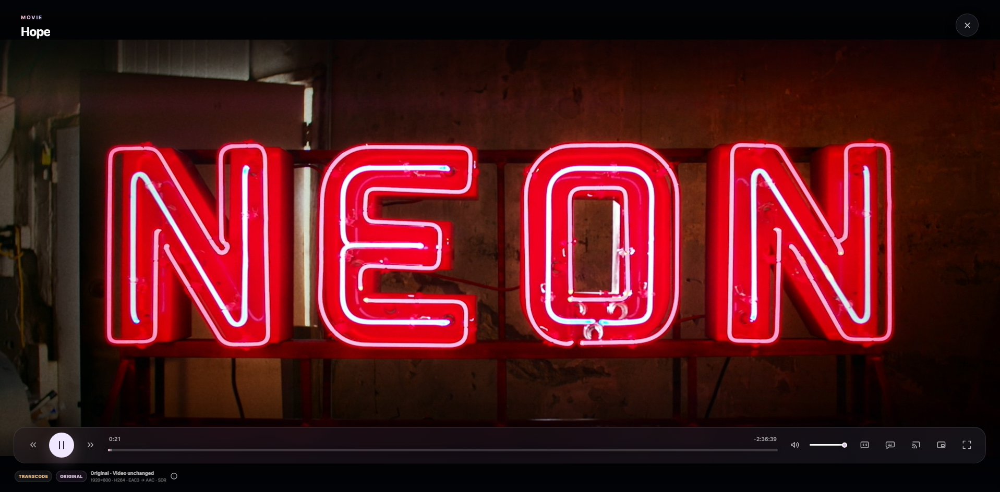
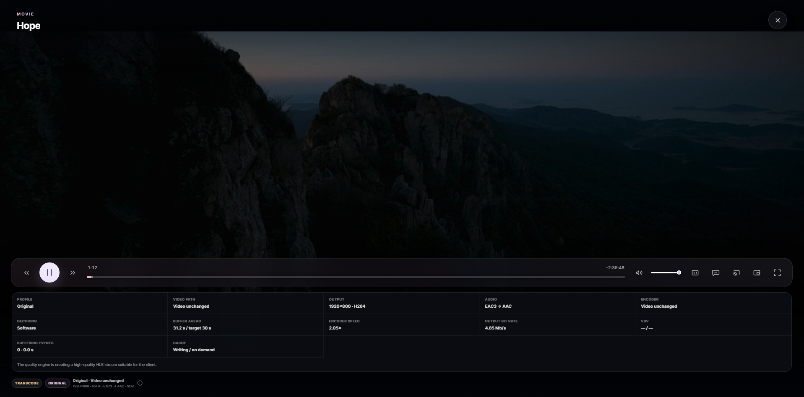

# KoduMedia

[English](README.md) · [Esmase kasutuse juhend](docs/ESMANE-KASUTUS.et.md) · [Muudatuste ajalugu](CHANGELOG.md) · [Turvalisus](SECURITY.md) · [Panustamine](CONTRIBUTING.md)


KoduMedia on Windowsile mõeldud isemajutatud meediaserver. Go server ja
Reacti veebiliides võimaldavad koduvõrgus filme, seriaale ning muusikat sirvida
ja esitada.

Praegune versioon on **0.8.57**.

[](docs/screenshots/home-overview.png)

<p align="center"><em>Sinu filmid, seriaalid ja muusika ühes kinolikus avalehe vaates.</em></p>

> [!WARNING]
> KoduMedial pole veel kasutajakontosid, TLS-i ega turvalist internetipõhist
> kaugjuurdepääsu. Hoia port `8096` ainult usaldatud privaatvõrgus.

## Peamised võimalused

- Filmid, seriaalid ja muusika ühes responsiivses veebiliideses.
- Direct Play, remux või HLS-transkodeerimine vastavalt faili ja kliendi
  tegelikele omadustele.
- HDR-i tuvastamine, riistvaralise kodeerija kontroll ja töökindel SDR fallback.
- Kohalikud ja faili sisse pakitud subtiitrid ning valikuline OpenSubtitles.com.
- TMDb metaandmed ja pildid, IMDb reitingud ning muusika metaandmete rikastamine.
- AirPlay, brauseri Remote Playback, Google Cast ja serveripoolne DLNA/UPnP.
- Vaatamisjärg, „Jätka vaatamist” ja järgmise osa soovitused.
- Eesti- ja ingliskeelne kasutajaliides.
- Portable Windowsi väljalase koos FFmpegi ja FFprobe'iga.

## Kuvatõmmised

<table>
  <tr>
    <td width="50%">
      <a href="docs/screenshots/series-details.png"></a><br>
      <strong>Seriaalid ja osad</strong><br>
      Vaata teose infot, hooaegu ja serveris olevaid osi ühelt ekraanilt.
    </td>
    <td width="50%">
      <a href="docs/screenshots/media-details.png"></a><br>
      <strong>Põhjalik meediainfo</strong><br>
      Kontrolli enne esitamist näitlejaid, koodekit, resolutsiooni, heli ja failiinfot.
    </td>
  </tr>
  <tr>
    <td width="50%">
      <a href="docs/screenshots/player-playback.png"></a><br>
      <strong>Kinolik brauseriplayer</strong><br>
      Esita filme ja seriaale koos ajajoone, subtiitrite, heli, castimise ja täisekraani juhtnuppudega.
    </td>
    <td width="50%">
      <a href="docs/screenshots/player-diagnostics.png"></a><br>
      <strong>Esituse diagnostika</strong><br>
      Vaata aktiivset profiili, koodekeid, puhvrit, encoder'i kiirust, bitrate'i ja cache'i olekut.
    </td>
  </tr>
</table>

## Nõuded

### Valmis väljalaske kasutamine

- Windows 10 või Windows 11, x64.
- Tänapäevane veebibrauser samas usaldatud koduvõrgus.
- Soovi korral tasuta TMDb, AcoustID ja OpenSubtitles.com ligipääsuandmed.

KoduMedia paketis pole kellegi API-võtmeid. Seadetes sisestatud võtmed
salvestatakse kohalikku `data` kausta, mida Git ei jälgi.

### Lähtekoodist ehitamine

- Go 1.23 või uuem.
- Node.js 22 LTS või muu `apps/web/package.json` failis lubatud versioon.
- npm 10.8.2 või uuem.
- PowerShell 5.1 või uuem.
- Ametliku EXE ehitamiseks Windows 10/11 x64.
- NSIS 3.08 või uuem ainult installeri ehitamiseks.

## Paigaldamine

1. Ava [Releases](https://github.com/mihkelwow/kodumedia/releases).
2. Laadi uusim `kodumedia-<versioon>-windows-x64.zip`.
3. Paki kogu ZIP lahti kirjutusõigusega kausta.
4. Käivita `start-kodumedia.cmd`.
5. Ava serveriarvutis `http://localhost:8096`.
6. Teises sama võrgu seadmes ava `http://SERVERI-LAN-IP:8096`.

Windows Defender Firewalli küsimuse korral luba ainult **Private networks**.

Tee veebiliideses esmane seadistus:

1. Lisa filmi-, seriaali- ja muusikakaustad.
2. Lisa metaandmete jaoks tasuta TMDb API Read Access Token.
3. Soovi korral seadista AcoustID ja OpenSubtitles.com.
4. Salvesta seaded ja skänni meediakogud.

Ekraan-ekraanilt selgituse, teiste seadmete ühendamise, castimise, uuendamise
ja levinud probleemide lahendused leiad
[esmase kasutuse juhendist](docs/ESMANE-KASUTUS.et.md).

## Castimine

Player näitab neid võimalusi, mida kasutatav brauser ja võrk parajasti toetavad:

- **AirPlay** kasutab toetatud Apple'i seadmes native HLS-i.
- **Google Cast** vajab turvalist brauserikonteksti, näiteks HTTPS-i.
- **DLNA/UPnP** seadmete leidmise ja juhtimise teeb KoduMedia server.

KoduMedia kasutab Samsungi ja teiste DLNA-telerite jaoks MPEG-TS HLS-i
ning teadlikku alguspuhvrit. Seetõttu võib DLNA esitus enne sujuvat käivitumist
oodata 12–20 sekundit.

Täpne ühilduvus sõltub teleri mudelist ja püsivarast, brauserist, võrgu
kvaliteedist ning lähtefaili formaadist.

## Seadistus ja saladused

Kui vajad keskkonnamuutujaid, kopeeri `.env.example` fail `.env` nime alla.
Näidisfaili väärtused peavad jääma tühjaks.

```powershell
Copy-Item .env.example .env
```

Ära lisa Giti:

- `.env` faili ega muid kohalikke keskkonnafaile;
- `data` kausta või eksporditud seadeid;
- API-võtmeid, tokeneid, paroole ega küpsiseid;
- isiklikke meediafaile, subtiitreid või metaandmete vahemälu;
- ehitatud EXE-faile, FFmpegi binaare ega väljalaske-ZIP-e.

`.gitignore` välistab need failid. GitHubi saladuste skannimine on täiendav
turvavõrk, mitte asendus muudatuste ülevaatamisele enne commit'i.

## Ehitamine ja testimine

Windowsis projekti juurkaustast:

```powershell
.\test.ps1
.\build.ps1
```

`test.ps1` paigaldab lukustatud veebisõltuvused, kontrollib avalikku npm
registrit ja tõlkeid, käivitab kasutajaliidese testid, ehitab veebirakenduse,
sünkroniseerib selle Go embed-kausta ning käivitab `go test` ja `go vet`.

`build.ps1` loob Windowsi binaarid kausta `dist\windows-x64`.

Kui npm sõltuvused on juba paigaldatud:

```powershell
.\test.ps1 -SkipNpmInstall
.\build.ps1 -SkipNpmInstall
```

## Projekti ülesehitus

```text
apps/server/                    Go server ja Windowsi käivitatavad failid
apps/server/internal/domain     Puhas domeenimudel
apps/server/internal/ports      Adapterite lepingud
apps/server/internal/service    Kasutusjuhud ja playback'i planeerimine
apps/server/internal/adapters   Meedia, metadata, subtiitrid, cast ja salvestus
apps/server/internal/transport  HTTP API
apps/web/                       Reacti ja TypeScripti veebiklient
api/openapi.yaml                HTTP API kirjeldus
docs/                           Arhitektuur, turvalisus ja teekaart
scripts/windows/                Ühised PowerShelli build'i abifunktsioonid
tools/ffmpeg/                   FFmpegi litsents ja build'i päritolu
```

Detailsem info on failides [ARCHITECTURE.md](docs/ARCHITECTURE.md) ja
[openapi.yaml](api/openapi.yaml).

## Panustamine ja litsents

Enne pull request'i loe [CONTRIBUTING.md](CONTRIBUTING.md). Kõik kasutajale
nähtavad kasutajaliidese tekstid peavad olema nii eesti kui ka inglise keeles.

Turvaprobleemist teata vastavalt failile [SECURITY.md](SECURITY.md); ära avalda
avalikus issue's võtmeid ega kasutatavat ründekirjeldust.

KoduMedia on avaldatud
[GNU General Public License v3.0 only](LICENSE) tingimustel. Kolmandate osapoolte
litsentsid on failis [THIRD-PARTY-NOTICES.txt](THIRD-PARTY-NOTICES.txt).

### Arenduse läbipaistvus

KoduMedia on õppimiseks ja katsetamiseks loodud prompt-driven ning AI-assisted
projekt. Projekti omanik määratles nõuded, tegi tooteotsused, testis tulemusi ja
juhtis iga iteratsiooni, kuid ei kirjutanud lähtekoodi käsitsi. AI kasutamine ei
muuda projekti GPL-3.0-only litsentsi ega kaota vajadust muudatusi üle vaadata ja
testida.
