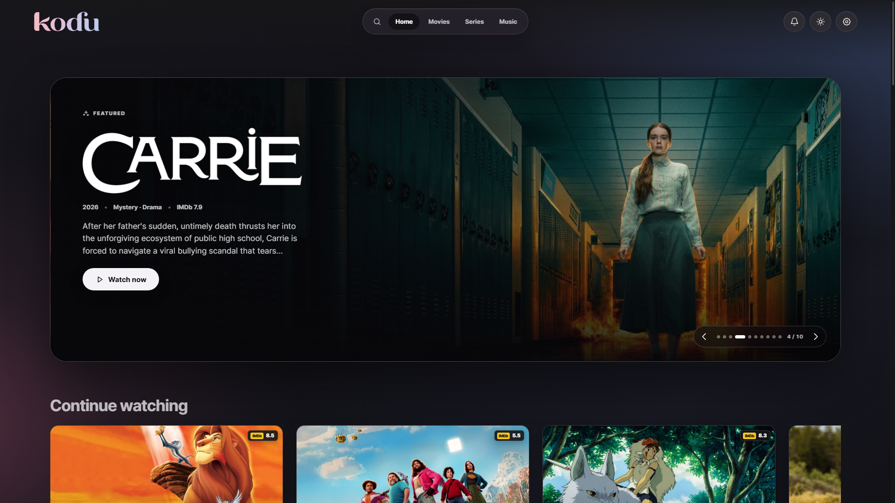
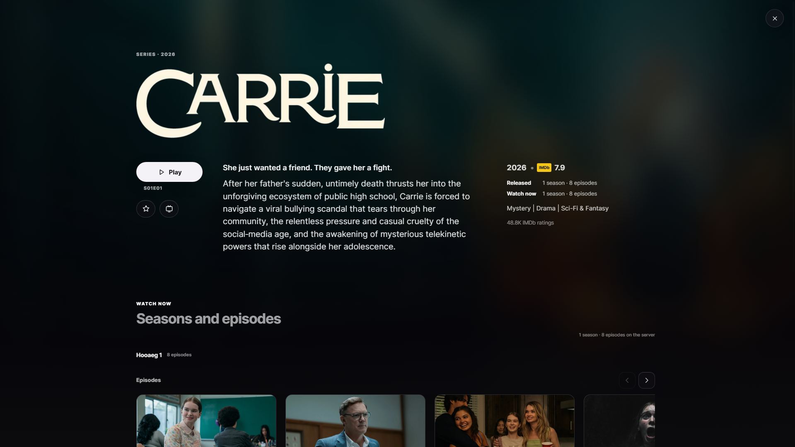
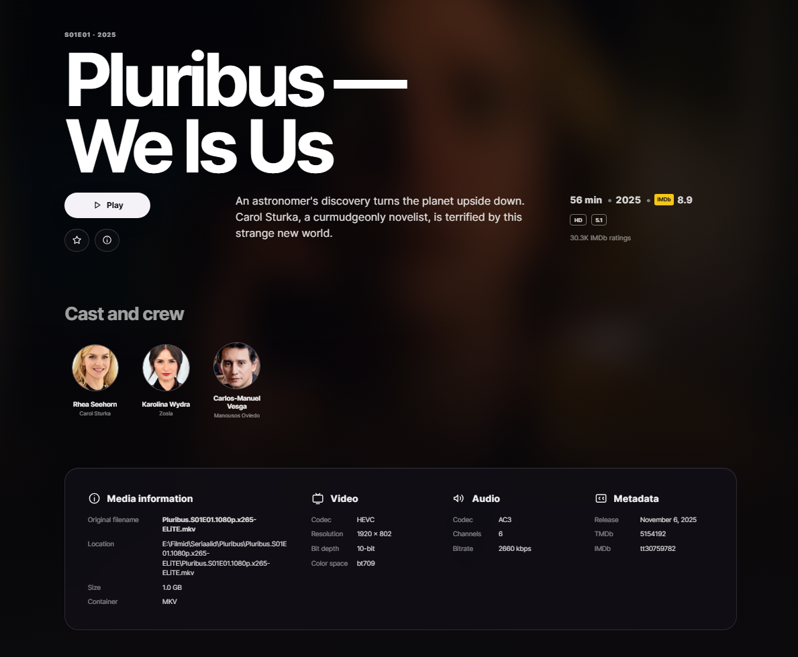

# KoduMedia

[Eesti keeles](README.et.md) · [Getting started](docs/GETTING-STARTED.md) · [Changelog](CHANGELOG.md) · [Security](SECURITY.md) · [Contributing](CONTRIBUTING.md)


[](https://github.com/mihkelwow/kodumedia/actions/workflows/ci.yml)
[](LICENSE)
[](#requirements)

KoduMedia is a self-hosted media server for Windows. It combines a Go backend
with a responsive React web interface for browsing and playing movies, TV
series and music on a trusted home network.

The current release is **0.8.56**.

[](docs/screenshots/home-overview.png)

<p align="center"><em>Your movies, series and music in one cinematic home interface.</em></p>

> [!WARNING]
> KoduMedia does not yet provide user accounts, TLS or secure internet-facing
> remote access. Keep port `8096` restricted to trusted private networks.

## Highlights

- Movies, TV series and music in one responsive browser interface.
- Direct Play, remuxing and HLS transcoding selected from actual media and
  client capabilities.
- HDR detection, hardware-encoder validation and controlled SDR fallback.
- Local and embedded subtitles plus optional OpenSubtitles.com integration.
- TMDb metadata and artwork, IMDb ratings and music metadata enrichment.
- AirPlay, browser Remote Playback, Google Cast and server-side DLNA/UPnP.
- Watch progress, continue watching and episode-aware post-play suggestions.
- Estonian and English user-interface translations.
- Portable Windows releases with FFmpeg and FFprobe included.

## Screenshots

<table>
  <tr>
    <td width="50%">
      <a href="docs/screenshots/series-details.png"></a><br>
      <strong>Series and episodes</strong><br>
      Browse title information, seasons and available episodes from one screen.
    </td>
    <td width="50%">
      <a href="docs/screenshots/media-details.png"></a><br>
      <strong>Rich media details</strong><br>
      Review cast, codec, resolution, audio and file information before playback.
    </td>
  </tr>
</table>

## Requirements

### Running a release

- Windows 10 or Windows 11, x64.
- A modern browser on the same trusted local network.
- Optional free API credentials for TMDb, AcoustID and OpenSubtitles.com.

KoduMedia never ships with a user's API credentials. Credentials entered in
Settings are stored under the local `data` directory, which is excluded from
Git.

### Building from source

- Go 1.23 or newer.
- Node.js 22 LTS or another version accepted by `apps/web/package.json`.
- npm 10.8.2 or newer.
- PowerShell 5.1 or newer.
- Windows 10/11 x64 for the official executable.
- NSIS 3.08 or newer only when building the optional installer.

## Install and run

1. Open [Releases](https://github.com/mihkelwow/kodumedia/releases).
2. Download `kodumedia-<version>-windows-x64.zip` from the newest release.
3. Extract the complete ZIP into a writable folder.
4. Run `start-kodumedia.cmd`.
5. Open `http://localhost:8096` on the server computer.
6. From another device on the same network, open
   `http://SERVER-LAN-IP:8096`.

When Windows Defender Firewall asks for access, allow **Private networks** only.

Complete first-time setup in **Settings**:

1. Add movie, series and music folders.
2. Add a free TMDb API Read Access Token for metadata.
3. Optionally configure AcoustID and OpenSubtitles.com.
4. Save settings and scan the media libraries.

For a screen-by-screen explanation, including local-network access, casting,
updating and common problems, read the
[first-time user guide](docs/GETTING-STARTED.md).

## Casting and external playback

The player exposes the methods available for the current browser and network:

- **AirPlay** uses native HLS on supported Apple devices.
- **Google Cast** requires a secure browser context such as HTTPS.
- **DLNA/UPnP** discovery and control are handled by the KoduMedia server.

KoduMedia 0.8.56 uses MPEG-TS HLS and a deliberate startup buffer for Samsung
and other DLNA televisions. A DLNA session may therefore take 12–20 seconds to
start before steady playback begins.

Device and codec support still varies by television model, firmware, browser,
network quality and source media.

## Configuration and secrets

Copy `.env.example` to `.env` only if environment-based configuration is
needed. Leave `.env.example` values empty.

```powershell
Copy-Item .env.example .env
```

Never commit any of the following:

- `.env` or another local environment file;
- the `data` directory or exported settings;
- API keys, access tokens, account passwords or cookies;
- personal media, subtitles or metadata caches;
- built executables, FFmpeg binaries or release ZIP files.

The repository's `.gitignore` excludes these paths. GitHub secret scanning is
an additional safety net, not a replacement for checking changes before every
commit.

## Build and test

From the repository root on Windows:

```powershell
.\test.ps1
.\build.ps1
```

`test.ps1` installs the locked web dependencies, validates the public npm
registry and UI translations, runs frontend tests, builds the web application,
syncs it into the Go embed directory, and runs `go test` plus `go vet`.

`build.ps1` creates Windows binaries under `dist\windows-x64`.

To avoid installing npm dependencies again:

```powershell
.\test.ps1 -SkipNpmInstall
.\build.ps1 -SkipNpmInstall
```

## Repository structure

```text
apps/server/                    Go server and Windows executables
apps/server/internal/domain     Core domain model
apps/server/internal/ports      Adapter contracts
apps/server/internal/service    Application services and playback planning
apps/server/internal/adapters   Media, metadata, subtitles, casting and storage
apps/server/internal/transport  HTTP API
apps/web/                       React and TypeScript web client
api/openapi.yaml                HTTP API description
docs/                           Architecture, security and roadmap documents
scripts/windows/                Shared PowerShell build helpers
tools/ffmpeg/                   FFmpeg licensing and build provenance
```

See [Architecture](docs/ARCHITECTURE.md) and the
[OpenAPI description](api/openapi.yaml) for implementation details.

## Contributing

Contributions are welcome. Read [CONTRIBUTING.md](CONTRIBUTING.md) before
opening a pull request. Every user-facing UI string must have both Estonian and
English translations, and all applicable checks must pass.

Please report security issues according to [SECURITY.md](SECURITY.md), not in a
public issue containing exploit details or credentials.

## License

KoduMedia is licensed under the
[GNU General Public License v3.0 only](LICENSE).

Third-party components retain their own licenses. See
[THIRD-PARTY-NOTICES.txt](THIRD-PARTY-NOTICES.txt). The official Windows release
includes a GPL build of FFmpeg; its license and source-build provenance are
included in `tools/ffmpeg` and in every release package.
